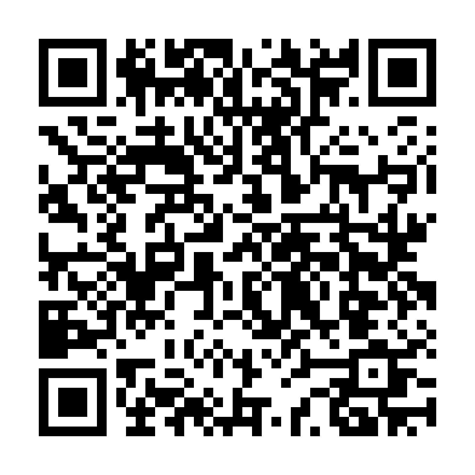

# Tetra Mix

**Live production for churches, events and streamers - on one Windows PC.**

Switch cameras, show scripture and lyrics automatically as the preacher speaks, add titles, and stream to several platforms at once while recording.

**Free download from the Microsoft Store:** https://apps.microsoft.com/detail/9NQ484L0J48M

Scan with your phone camera to open the Store page.

---

## What it does

### Live switching
- Preview / Program switching with a TAKE button, cuts, transitions and smooth "glide" moves
- Multiview: see all your inputs at once
- Lock an input to the screen so it stays on air through every switch
- Edit layouts directly on Preview and keep saved layouts ready

### Inputs
- USB and capture-card cameras
- Your phone as a wireless camera (SRT / Larix, or straight from the phone's browser)
- NDI® sources on your network (needs the free NDI Runtime - the app shows you where to get it)
- Videos, images, PDFs, PowerPoint / Word / Excel files as slides
- One-click capture of any application window

### AI that follows your service
- **Auto-cue scripture:** the preacher says a verse and it is ready on screen
- Recognises verses that are quoted, not only references
- Song lyrics follow along as the congregation sings
- Two languages side by side (for example English and Yoruba)
- Background removal without a green screen, and automatic framing of the speaker

Speech recognition runs **on your own PC** - your audio is never sent anywhere.

### Graphics
- Lower thirds with your logo, social-media handles, clock
- Branded scripture look: your own background, preacher frame and logos
- HTML title designer, 3D perspective effect, crop / zoom / rounded frames

### Streaming and recording
- Stream to several platforms at once (YouTube, Facebook and more)
- A vertical 9:16 output for TikTok, Reels and Shorts at the same time
- Built for weak internet: fast reconnects, upload speed test before going live
- Multi-track recording with pause, split, low-disk warning and instant replay

### Audio
- Mixer with voice filters, presets, pan / mono
- Automatic loudness levelling and limiter on the stream

### For the booth
- MIDI and Stream Deck control
- Modes for church, events and presentations
- CPU / GPU / memory monitor; recovers by itself if the video engine crashes
- English and Yoruba interface

## System requirements

| | |
|---|---|
| Windows | Windows 10 (version 2004 or later) or Windows 11, 64-bit |
| Graphics | NVIDIA RTX recommended for the AI features. AMD and Intel graphics are supported, with AI features in early support. |

## Feedback and help

- **Found a problem?** [Report it here](../../issues/new/choose)
- **Questions and ideas:** [Discussions](../../discussions)
- **No GitHub account?** Email **tetramostechnologies@gmail.com**

Please include the Tetra Mix version - it is shown on the System Check screen.

## Support Tetra Mix

Tetra Mix is free. If it helps your church or event, you can support its development. Thank you!

### From Nigeria (bank transfer)

| | |
|---|---|
| Bank | Guaranty Trust Bank (GTBank) |
| Account name | Matthew Abodunrin |
| Account number | **0108909000** (Naira) |

### From outside Nigeria (international transfer)

| Currency | GTBank account number |
|---|---|
| US Dollars (USD) | **0892486349** |
| British Pounds (GBP) | **0892486356** |
| Euros (EUR) | **0892486363** |

Account name: Matthew Abodunrin. Give your bank the instructions for your currency below (from GTBank's published receiving instructions). Please send in the same currency as the account.

<b>US Dollars (USD) - wire instructions</b>

| | |
|---|---|
| Correspondent bank | Citibank, New York |
| Correspondent SWIFT | CITIUS33 |
| Fedwire / ABA | 021000089 |
| For credit of | Guaranty Trust Bank Plc, Lagos, Nigeria |
| Beneficiary bank SWIFT | GTBINGLA |
| GTBank's account with Citibank New York | 36129295 |
| For final credit of | **Matthew Abodunrin** |
| Beneficiary account number (with GTBank) | **0892486349** |
| Reference | Tetra Mix support |

<b>British Pounds (GBP) - transfer instructions</b>

| | |
|---|---|
| Correspondent bank | Citibank, London |
| Correspondent SWIFT | CITIGB2L |
| Sort code | 185008 |
| For credit of | Guaranty Trust Bank Plc, Lagos, Nigeria |
| Beneficiary bank SWIFT | GTBINGLA |
| GTBank's IBAN with Citibank London | GB72 CITI 1850 0850 0808 3157 95 |
| For final credit of | **Matthew Abodunrin** |
| Beneficiary account number (with GTBank) | **0892486356** |
| Reference | Tetra Mix support |

<b>Euros (EUR) - transfer instructions</b>

| | |
|---|---|
| Correspondent bank | Deutsche Bank, Frankfurt |
| Correspondent SWIFT | DEUTDEFF |
| Sort code | 50070010 |
| For credit of | Guaranty Trust Bank Plc, Lagos, Nigeria |
| Beneficiary bank SWIFT | GTBINGLA |
| GTBank's IBAN with Deutsche Bank Frankfurt | DE84 5007 0010 0955 7224 01 |
| For final credit of | **Matthew Abodunrin** |
| Beneficiary account number (with GTBank) | **0892486363** |
| Reference | Tetra Mix support |

International transfers carry bank fees on the sender's side. If your bank asks for anything not listed here, email **tetramostechnologies@gmail.com**.

If you would like a thank-you or a receipt, email us after you send it.

## Privacy

Tetra Mix has no accounts, no ads and no analytics. Read the full [privacy policy](PRIVACY.md).

## Licences and source code

Tetra Mix's video engine is built on [OBS Studio](https://obsproject.com) (GNU GPL v2). The engine's complete source code is included inside the app (the `licenses` folder), together with a written offer for the full OBS source. To request it, email tetramostechnologies@gmail.com.

Only Bible translations believed to be in the public domain are included. If you hold rights to one of them, please contact us.

NDI® is a registered trademark of Vizrt NDI AB.

---

© 2026 TetraMos Technologies, Lagos, Nigeria
